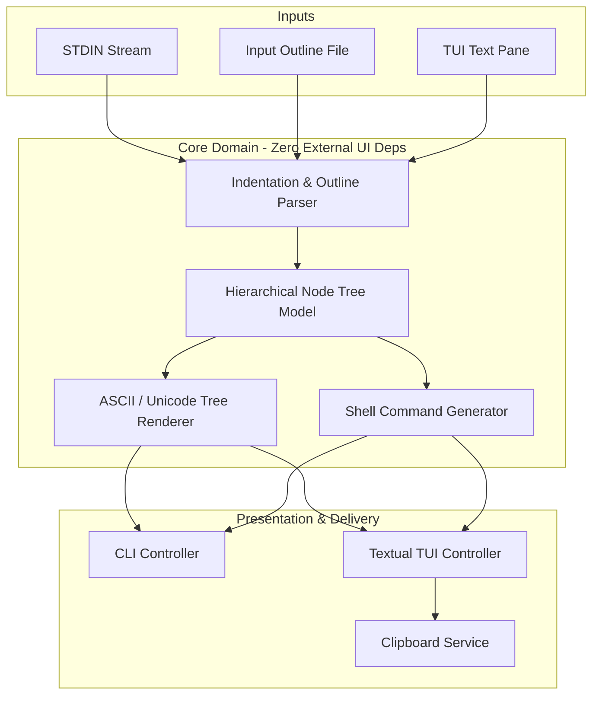

# Technical Specification Contract: `tree-tui`

**Document Version:** 1.1.0  
**Methodology:** Specification-Driven Development (SDD) & Test-Driven Development (TDD)  
**Status:** Approved / Base Contract  
**Related PRD:** [PRD.md](PRD.md)

---

## 1. System Architecture Overview

`tree-tui` is a decoupled, modular terminal utility written in Python. To support rigorous TDD and strict performance targets (<16ms re-rendering for 1,000 lines), the application separates core domain logic (parsing, tree-model construction, ASCII rendering, shell script synthesis) from presentation layers (CLI parsing and Textual TUI).



---

## 2. Core Modules & Formal Contracts

### 2.1 Domain Model: `tree_tui.core.model`

#### Classes and Types
```python
from __future__ import annotations
from dataclasses import dataclass, field
from enum import Enum
from typing import List, Optional

class NodeType(Enum):
    DIRECTORY = "directory"
    FILE = "file"

@dataclass(slots=True)
class TreeNode:
    name: str
    node_type: NodeType
    children: List[TreeNode] = field(default_factory=list)
    parent: Optional[TreeNode] = field(default=None, repr=False)

    def add_child(self, child: TreeNode) -> None:
        child.parent = self
        self.children.append(child)

    @property
    def is_dir(self) -> bool:
        return self.node_type == NodeType.DIRECTORY or len(self.children) > 0
```

#### Invariants:
- A node with a trailing slash (`/`) is explicitly a `DIRECTORY`.
- A node containing children is implicitly a `DIRECTORY` regardless of trailing slash.
- Root can be a single root node or an implicit virtual root holding multiple top-level nodes.

---

### 2.2 Parser Specification: `tree_tui.core.parser`

#### Function Signature:
```python
def parse_outline(text: str) -> TreeNode:
    """
    Parses indented text outlines into a canonical TreeNode hierarchy.
    
    Supported input forms:
    - Arbitrary consistent spaces per indent (2-space, 4-space, etc.)
    - Tabs (\t)
    - Bullet / list markers: '-', '*', '+' (e.g. '- dir/', '  * file.txt')
    - Tree diagram prefix characters if pasted (e.g. '|--', '`--')
    - Ignores blank and comment lines (#).
    
    Raises:
        ValueError: If indentation jump is invalid (e.g., nesting 2 levels deeper than parent).
    """
```

#### Parsing Rules & Edge Cases:
1. **Empty Lines:** Empty or whitespace-only lines are ignored.
2. **Comment Lines:** Lines starting with optional whitespace followed by `#` are ignored.
3. **List Prefix Stripping:** Regex pattern `^\s*([-*+]|\d+\.)\s+` strips bullet/list markers while preserving indentation level.
4. **Indentation Measurement:** Converts tabs to spaces (default tab stop: 4) or measures leading indent depth using a monotonic stack of indentation levels.
5. **Multiple Roots:** If multiple items have 0 indentation, an implicit virtual root (`name=""`) wraps them.

---

### 2.3 Renderer Specification: `tree_tui.core.renderer`

#### Glyphs & Characters
```python
@dataclass(frozen=True)
class TreeGlyphs:
    branch: str = "├── "
    last_branch: str = "└── "
    vertical: str = "│   "
    space: str = "    "

GLYPHS_UNICODE = TreeGlyphs()
GLYPHS_ASCII = TreeGlyphs(branch="|-- ", last_branch="`-- ", vertical="|   ", space="    ")
```

#### Function Signature:
```python
def render_tree(root: TreeNode, glyphs: TreeGlyphs = GLYPHS_UNICODE) -> str:
    """
    Renders TreeNode into an ASCII/Unicode hierarchy string.
    
    - Excludes implicit virtual root from rendering if name is empty.
    - Last child in any subtree uses `last_branch` and child prefixes use `space`.
    - Intermediate children use `branch` and child prefixes use `vertical`.
    """
```

---

### 2.4 Shell Command Generator: `tree_tui.core.generator`

Generates deterministic, idempotent, single-statement or chained POSIX-compliant shell commands to reproduce the directory and file tree.

#### Target Output Format:
- Uses `mkdir -p` for directories.
- Uses `touch` for files.
- Handles paths with spaces and special characters using `shlex.quote`.
- Optimizes output:
  - If a file `a/b/c.py` is touched, `mkdir -p a/b` is guaranteed before `touch a/b/c.py`.
  - Leaf empty directories are created with `mkdir -p <dir>`.
  - Command is formatted cleanly either as an executable multi-line script or a single one-liner chain (`&&`).

#### Function Signature:
```python
def generate_shell_command(root: TreeNode, one_liner: bool = False) -> str:
    """
    Generates POSIX shell commands (mkdir -p / touch) to reproduce the directory tree.
    """
```

#### Example Output:
```bash
mkdir -p src/utils tests
touch src/__init__.py src/main.py src/utils/helpers.py tests/test_main.py
```

---

### 2.5 Clipboard Integration: `tree_tui.platform.clipboard`

Zero heavy dependencies (like `pyperclip`). Native OS clipboard dispatch:
1. **macOS:** `pbcopy` via `subprocess.run(["pbcopy"], input=text.encode("utf-8"))`
2. **Wayland:** `wl-copy`
3. **X11:** `xclip -selection clipboard` or `xsel --clipboard --input`
4. Fallback: Graceful error status message in TUI if no clipboard binary is found.

---

### 2.6 Interactive TUI Specification: `tree_tui.tui.app`

Built with **Textual**:
- **Layout:**
  - `Header`: Title and mode status.
  - `Horizontal` container with two panes:
    - `TextArea` (Left, ID `#editor`): Plain text outline editor with line numbers.
    - `Static` or `RichLog` (Right, ID `#preview`): Rendered tree output with syntax styling.
  - `Footer`: Keybinding legend.
- **Keybindings:**
  - `ctrl+c` / `q`: Quit.
  - `ctrl+y` or `ctrl+b`: Copy rendered tree diagram to clipboard.
  - `ctrl+g`: Copy generated shell command (`mkdir`/`touch`) to clipboard.
  - `ctrl+r`: Reset editor to default starter template.
  - `f1` or `?`: Show modal help screen with keyboard shortcuts and syntax tips.
- **Reactivity:**
  - On `TextArea.Changed`, trigger a debounced (10ms) parse & render update loop.
  - Display non-blocking error badge if parsing fails (e.g. malformed indent jump), retaining previous valid tree.

---

## 3. Test-Driven Development (TDD) Contract & Test Matrix

Unit and integration tests must precede or accompany implementation with 100% pass requirement.

### 3.1 Unit Test Modules

| Test File                 | Target Module        | Test Scenarios                                                                                                             |
| :------------------------ | :------------------- | :------------------------------------------------------------------------------------------------------------------------- |
| `tests/test_model.py`     | `core.model`         | Node insertion, parent-child links, leaf vs dir detection.                                                                 |
| `tests/test_parser.py`    | `core.parser`        | 2-space, 4-space, tabs, mixed bullet prefixes (`-`, `*`), comments `#`, empty lines, trailing slashes, indentation errors. |
| `tests/test_renderer.py`  | `core.renderer`      | Unicode branches (`├──`, `└──`), ASCII fallback (`\|--`, `` `-- ``), single-node, multi-root, deeply nested trees.         |
| `tests/test_generator.py` | `core.generator`     | Escaping paths with spaces, pure dir trees, pure file trees, mixed hierarchies, one-liner vs multi-line output.            |
| `tests/test_clipboard.py` | `platform.clipboard` | Clipboard dispatch mocking for macOS, Wayland, X11, and missing binary fallback.                                           |
| `tests/test_cli.py`       | `cli`                | STDIN piping (`-t`), outline file path ingestion, ASCII flag (`--ascii`), command generation flag (`-c`).                  |

---

## 4. Benchmark & Performance Contract

- **Parsing + Rendering Speed:**
  - Synthetic input of 1,000 lines nested up to 10 levels.
  - Must complete in < 16ms on baseline modern hardware (Apple M-series or Intel i5+).
  - Enforced via benchmark test (`tests/test_perf.py`).

---

## 5. Technology Stack & Project Structure

- **Language:** Python >= 3.11
- **Package Manager / Build System:** `uv` (`pyproject.toml`, `hatchling` backend)
- **TUI Framework:** `textual` (latest stable)
- **Testing:** `pytest`, `pytest-benchmark`

```
tree-tui/
├── pyproject.toml
├── README.md
├── PRD.md
├── SPEC.md
├── AGENTS.md
├── TODO.md
├── src/
│   └── tree_tui/
│       ├── __init__.py
│       ├── cli.py
│       ├── core/
│       │   ├── __init__.py
│       │   ├── generator.py
│       │   ├── model.py
│       │   ├── parser.py
│       │   └── renderer.py
│       ├── platform/
│       │   ├── __init__.py
│       │   └── clipboard.py
│       └── tui/
│           ├── __init__.py
│           ├── app.py
│           └── styles.tcss
└── tests/
    ├── __init__.py
    ├── test_cli.py
    ├── test_clipboard.py
    ├── test_generator.py
    ├── test_model.py
    ├── test_parser.py
    ├── test_perf.py
    ├── test_renderer.py
    └── test_tui.py
```
